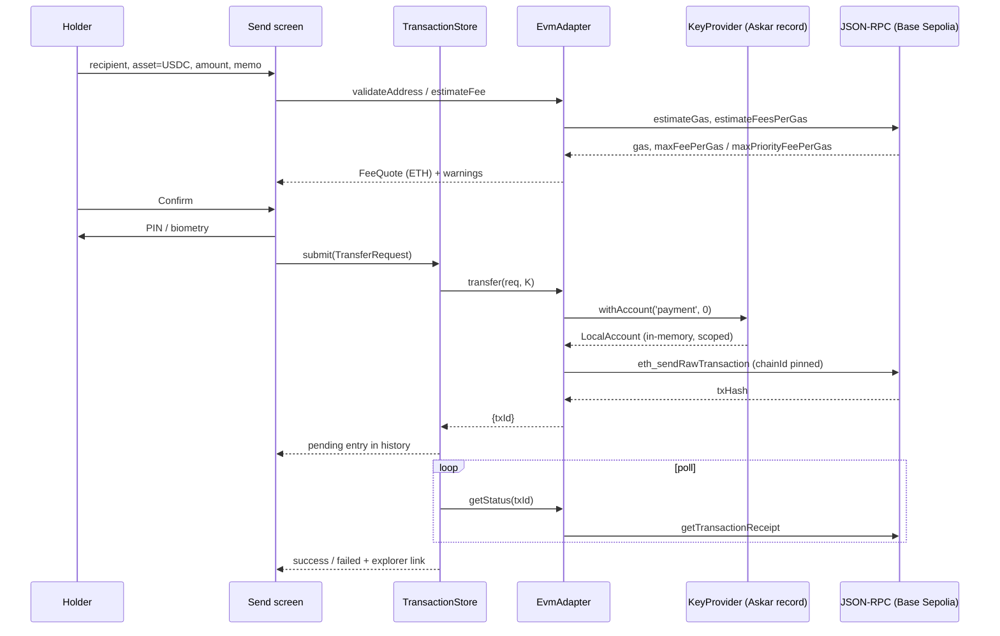
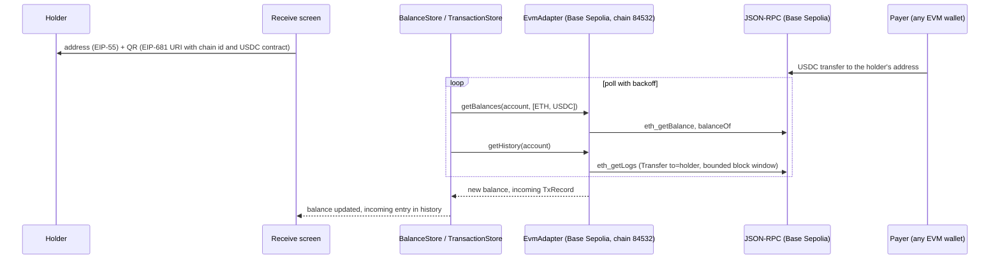
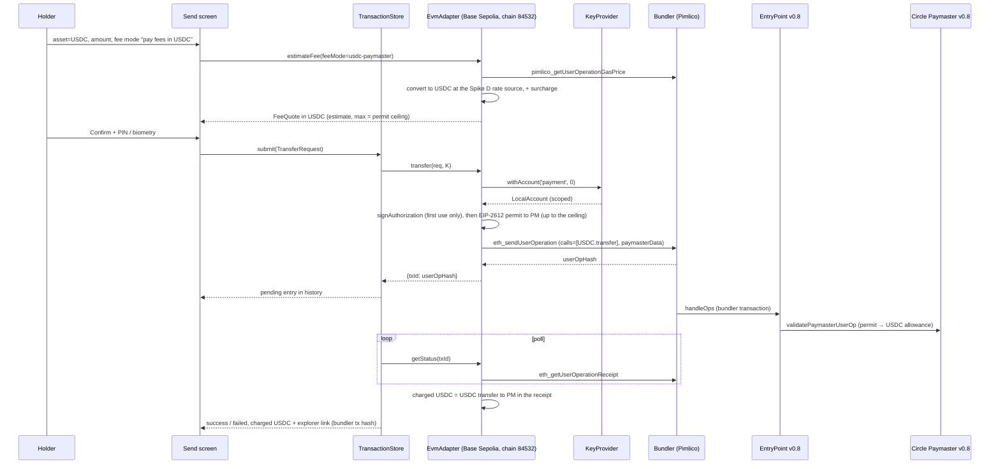
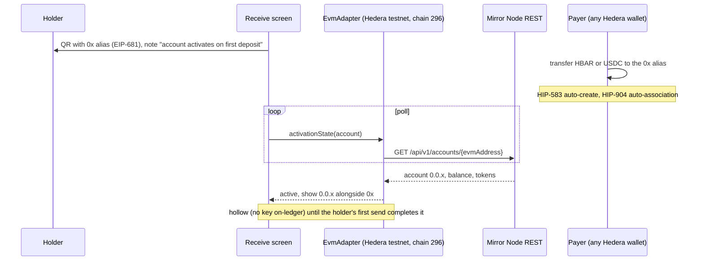

# Idea and high-level design

# 1\. The idea

Heka Wallet holds a person's verifiable credentials. This module adds a payment capability next to them, so the wallet that proves _"I am KYC-verified"_ or _"I act under this mandate"_ can also settle: send and receive a stablecoin, show history, and sign the on-chain bindings that permissioned-token and agent flows need. Identity and payment live in one holder wallet, under one PIN and one backup.

**Why stablecoin-first.** Stablecoins are the asset class enterprises are moving onto public chains. The US GENIUS Act's prudential rules for payment-stablecoin issuers are final (OCC final rule of 2026-10-21, effective 2027-01-18), euro stablecoins fall under MiCA's e-money-token regime, and Circle issues native USDC on 38 chains — Hedera included, where it is HTS token `0.0.456858` on mainnet (`0.0.429274` on testnet). Native coins such as HBAR or ETH are the fee asset, not the value being paid. Designing around the stablecoin keeps the module generic, and makes HBAR a configuration entry rather than a second codebase.

**Target use cases.**

-   **Compliance-gated stablecoin payment** — the payer presents a valid KYC credential before the transfer executes; revoking the credential freezes the rail (revocation needs credential status at issuance, §2.9).
-   **Agentic payment with mandate + KYC** — an AI agent settles after answering an in-task credential challenge; the mandate credential, the owner's KYC credential and the agent's registered wallet are checked before paying.
-   **Investor wallet for permissioned tokens** — the same wallet holds the KYC credential and an ERC-3643 security token; the wallet-to-holder binding is signed by the same key, so one revocation cuts both the credential and the on-chain permission (same prerequisite, §2.9).
-   **Travel-Rule-aware transfers (holder side)** — originator and beneficiary credentials exchanged before settlement; self-hosted-address proof by signing a nonce (stretch, F14; the nonce signature comes from F7).
-   **Stablecoin payroll or expenses to a verified employee** — an employee credential is checked at pay time.

The first two use cases bind the payment to a credential presentation. That binding is F12 (OID4VP `transaction_data`), which needs work in the Identity Service verifier and in the wallet's presentation screen (§2.9). Until F12 lands, these scenarios are demonstrated in two separate steps: present the credential, then pay from an EIP-681 QR.

**The approach.**

-   **One chain-agnostic core, adapters per chain.** Chains and assets are identified with CAIP-2 / CAIP-19 ids; a `ChainAdapter` interface covers balances, fees, transfers, status and history; MobX stores and the screens are shared by every chain.
-   **EVM adapter first, chains as configuration.** The first adapter is built on viem. Base Sepolia (USDC with Circle Paymaster; EURC is available there for F11) is the default entry, or Arbitrum Sepolia if Spike D finds no paymaster on Base Sepolia; Hedera testnet is the second entry through Hedera's Ethereum-compatible JSON-RPC relay (chain id 296), where HBAR is the native asset and USDC is an HTS token behind Hedera's ERC-20 facade. The same code serves both, and the Hedera-specific behaviour (alias account activation, token association, 8-decimal units, Mirror Node history) is isolated in one folder.
-   **Fees payable in USDC where a paymaster exists.** On chains with Circle Paymaster, the holder's account is upgraded in place with an EIP-7702 authorization and the transfer is submitted as a user operation whose gas is paid in USDC through an EIP-2612 permit. The address does not change. Elsewhere — Hedera included, since EIP-7702 is deactivated there today — fees are paid in the native asset.
-   **One seed, one PIN, one backup.** A BIP-39 seed stored in the wallet's existing Askar store, secp256k1 accounts derived on demand, keys held in memory only for the duration of a signature. Hedera's relay only accepts ECDSA accounts, and Askar cannot produce Ethereum signatures, so secp256k1 throughout and signing in the EVM library is the only model that gives one account across chains.
-   **Hedera-native adapter deferred, safely.** A Hiero SDK + Mirror Node adapter remains specified for native-only features. It can wait, because the MVP's Hedera account is an ECDSA account that the SDK derives from the same seed; nothing in the MVP depends on native-only APIs.
-   **Testnets only until rollout.** Mainnet chain entries ship disabled; chains, RPC and bundler vendors are decided at the rollout phase.

**What ships in the MVP (Phases 0–2), subject to the Phase 0 spikes:**

-   USDC and ETH on Base Sepolia, with fees payable in USDC (Spike D: if it fails, fees stay in ETH; if only Arbitrum Sepolia works, that chain replaces Base Sepolia).
-   HBAR and USDC on Hedera testnet, through the same adapter (Spike B: if it fails, the Hedera entry leaves the MVP).
-   Create, import and back up the seed inside the identity wallet's existing unlock and backup flows (the passkey backup where `ENABLE_WALLET_BACKUP` is on; the verified recovery phrase everywhere).
-   Send, receive and history screens.
-   Typed-data signing for wallet-to-holder bindings, requested through a signing-request QR / deep link and approved on a confirm-before-sign screen.

---

# 2\. High-level design

## 2.1 Personas and the on-chain / off-chain split

| Persona | Role | Footprint | Heka component |
| --- | --- | --- | --- |
| Holder | Owns the seed, pays and receives, presents VCs | One secp256k1 key per account index; on-chain address; off-chain VCs in the same wallet | Heka Wallet + crypto module |
| Relying party / merchant / tokenisation platform | Receives payment, verifies credentials | Receiving address only; **never needs the holder's keys or gas** | Identity Service verifier (OID4VP), demo portals |
| Operator (platform team) | Ships the chain registry, RPC endpoints, feature flag | No user keys; keyless public endpoints on testnets; keyed RPC or bundler vendors only behind an operator-run proxy (Phase 4.3) | App config, env |
| Issuer / certification body | Issues the KYC / mandate VCs that gate payments | Off-chain | Identity Service tenant |

The module itself (F1–F8) needs no Identity Service change; it is wallet-only. The use cases need three pieces outside the wallet (§2.9):

-   credential status on SD-JWT VCs at issuance, for "revocation freezes the rail" (F13, Identity Service);
-   `transaction_data` in OID4VP verification sessions, to bind a payment to a presentation (F12, Identity Service verifier + wallet presentation screen);
-   a relying-party side that checks the on-chain payment and the payer-address binding (F14, demo projects).

The SSO service, SSO web UI and Identity Service web UI need no change.

## 2.2 Package layout

All payment packages live under `heka-wallet/packages/crypto/`. The root `package.json` workspaces gain `packages/crypto/*` next to `app` and `packages/*`.

```
heka-wallet/packages/crypto/core        (@heka-wallet/crypto-core — chain-agnostic logic, no React / React Native)
├── src/
│   ├── types/        ChainDescriptor, AssetDescriptor (CAIP-2 / CAIP-19 ids), Account, TransferRequest, FeeQuote, TxRecord
│   ├── adapter/      ChainAdapter interface, AdapterRegistry
│   ├── keys/         KeyProvider interface, AskarSeedStore (mnemonic ⇄ raw Askar entry), derivation helpers
│   ├── stores/       MobX: AccountStore, BalanceStore (poll + backoff), TransactionStore (pending → final, history pages)
│   ├── ledger/       LocalLedger: pending and sent TxRecords persisted as raw Askar entries, survives restart
│   ├── requests/     SigningRequest parser (heka-sign URI / QR), PresentationPayment (F12)
│   └── utils/        units (bigint ⇄ decimal string), eip681 (payment URI parse / build), caip (CAIP-2 / CAIP-10), formatting
heka-wallet/packages/crypto/ui          (@heka-wallet/crypto-ui — React Native screens over crypto/core)
├── src/
│   ├── provider/     CryptoProvider (registry + stores in React context)
│   ├── navigators/   CryptoStack {Main, Register}
│   ├── screens/      Home, Send, Receive, History, Register (create / verify / import), Settings, SignRequest, RevealPhrase
│   ├── components/   AmountInput (bigint-safe), AddressField (checksum, QR), AssetPicker, FeePreview, WordsCard, WordChip, ChainSwitcher, TxListItem, ActivationBanner
│   └── hooks/        screen logic (send form, register flow, reveal) over the core stores
heka-wallet/packages/crypto/evm         (@heka-wallet/crypto-evm — viem)
├── src/
│   ├── EvmAdapter.ts        native + ERC-20 transfer, balances, fee quote (native or USDC), status, logs-based history
│   ├── EvmAccount.ts        viem LocalAccount from KeyProvider, EIP-155 pinned
│   ├── chains/              baseSepolia.ts (USDC; EURC when F11 lands), hederaTestnet.ts; arbitrumSepolia.ts only if Spike D falls back; mainnet twins shipped disabled
│   ├── aa/                  Simple7702Upgrade.ts, BundlerClient.ts, CirclePaymaster.ts (EIP-2612 permit → paymasterData)
│   └── hedera/              MirrorNodeHistory.ts, HtsFacade.ts (associate / isAssociated), unit quirks
heka-wallet/packages/crypto/hedera      (Phase 5 — Hiero SDK + Mirror Node; §2.4)
heka-wallet/packages/crypto/walletconnect   (Phase 5 — Reown WalletKit; F9)
```

Dependency direction: `core` depends on nothing in the module; `evm` (and later `hedera`) depend on `core`; `ui` depends on `core` only and gets adapters through the registry; the `app` depends on `ui` and registers the adapters. `core` stays testable in plain Node without React Native mocks.

Reusable from the removed Keplr module's UX (in git history before PR #229), all network-agnostic:

-   mnemonic create / verify / import screens and `RegisterForm`;
-   address copy, amount and memo inputs;
-   provider and navigator shapes;
-   the `Crypto.*` localisation tree in the locale files (rewrite, don't delete). It is not fully unused: `ConfirmationInputModal` in `packages/shared` reads `Crypto.Register.Form.Password.Label` and `.Invalid`. Move those two keys to a neutral namespace (for example `PINConfirmation.*`) and update the modal in the same change, before the rest of the block is rewritten.

## 2.3 Core abstractions

```
type ChainId = `eip155:${number}` | `hedera:${'mainnet'|'testnet'}`      // CAIP-2
type AssetId = string                                                      // CAIP-19, e.g. 'eip155:84532/erc20:0x036C…CF7e'

interface AssetDescriptor { id: AssetId; symbol: string; name: string; decimals: number
  kind: 'native' | 'erc20' | 'hts'; address?: string; stable?: 'USD' | 'EUR' }

interface ChainDescriptor { id: ChainId; name: string; kind: 'evm' | 'hedera-native'
  rpcUrl?: string                                        // kind 'evm' only; a 'hedera-native' entry uses the SDK network name + mirrorNodeUrl
  explorer: { tx: (h: string) => string; address: (a: string) => string }
  nativeAsset: AssetDescriptor; assets: AssetDescriptor[]
  features: { historySource: 'rpc-logs' | 'mirror-node' | 'indexer'; autoCreateOnReceive: boolean; mirrorNodeUrl?: string
              paymaster?: { kind: 'circle'; version: '0.8'; address: string; bundlerUrl: string } } }   // absent on Hedera

type FeeMode = 'native' | 'usdc-paymaster'                 // 'usdc-paymaster' only where chain.features.paymaster exists
interface TransferRequest { from: Account; to: string; asset: AssetDescriptor; amount: bigint; memo?: string; feeMode: FeeMode; feeCap?: bigint }
interface FeeQuote { mode: FeeMode; asset: AssetDescriptor; amount: bigint; max?: bigint; display: string }   // max: the permit ceiling in 'usdc-paymaster' mode
type TxStatus = 'pending' | 'success' | 'failed' | 'unknown'
interface StatusResult { status: TxStatus; explorerHash?: string; fee?: { asset: AssetDescriptor; amount: bigint } }   // user operations: bundler hash and charged fee, known only once final

interface ChainAdapter {
  readonly chain: ChainDescriptor
  deriveAccount(keys: KeyProvider, index: number): Promise<Account>
  validateAddress(input: string): { ok: boolean; normalized?: string; warning?: string }
  getBalances(account: Account, assets: AssetDescriptor[]): Promise<Record<AssetId, bigint>>
  estimateFee(req: TransferRequest): Promise<FeeQuote>
  transfer(req: TransferRequest, keys: KeyProvider): Promise<{ txId: string; explorerHash?: string }>   // signs, submits, returns immediately
  getStatus(txId: string): Promise<StatusResult>
  getHistory(account: Account, cursor?: string): Promise<{ items: TxRecord[]; next?: string }>
  activationState?(account: Account): Promise<'active' | 'pending'>                 // Hedera alias accounts
  isAssetEnabled?(account: Account, asset: AssetDescriptor): Promise<boolean>      // Hedera: HTS association (facade isAssociated)
  enableAsset?(account: Account, asset: AssetDescriptor, keys: KeyProvider): Promise<{ txId: string }>   // Hedera: facade associate(), fee in HBAR
}

interface KeyProvider {
  hasSeed(): Promise<boolean>
  createSeed(words: 12 | 24): Promise<string>              // returns mnemonic once, for the verify screen
  importSeed(mnemonic: string): Promise<void>
  withAccount<T>(purpose: 'payment' | 'binding', index: number, fn: (account: LocalAccount) => Promise<T>): Promise<T>
                                                             // key lives only inside fn; 'binding' is a separate derivation branch (chosen per integration)
  revealMnemonic(auth: AuthProof): Promise<string>
}
```

Identifier choices: CAIP-2/CAIP-19 ids are what WalletConnect v2 and most multi-chain tooling use, so the Phase 5 dApp-pairing work needs no renaming.

## 2.4 Chain adapters

**EVM adapter (Phase 1).**

-   _Native transfer:_ an EIP-1559 transaction `{ to, value }`, signed by the adapter with the chain id it sets itself (checked in the serialized payload), sent with `eth_sendRawTransaction`; the RPC's `eth_chainId` is checked first.
-   _ERC-20 transfer:_ the same path with `to` = token contract and `data` = `transfer(recipient, amount)` (`erc20Abi`).
-   _Fees:_ `estimateFeesPerGas()`, `gas` from `estimateGas` × 1.2, refused (not clamped) above a per-chain gas ceiling.
-   _Status:_ `getTransactionReceipt` polled by the TransactionStore; no receipt = pending.
-   _History:_ ERC-20 `Transfer` logs (`getLogs` with `from`/`to` topics) over a bounded block window, merged with the local ledger. Public RPCs cap the `getLogs` range, so the window is a per-chain config value and older transfers outside it are only known from the local ledger. Inbound native transfers (ETH) emit no logs and appear only as a balance change; the History screen says that history is partial until an indexer source exists (F11).
-   _Nonces:_ the adapter takes the nonce from `getTransactionCount(address, 'pending')`; the TransactionStore allows one pending send per account and chain in the MVP, so back-to-back sends cannot collide. Speed-up and cancel (replacement by nonce) are out of scope for v1; a send pending longer than a per-chain timeout is shown as `unknown` with an explorer link.
-   _Recipient resolution:_ `0x` address (EIP-55), optional ENS on chains that have it, EIP-681 URIs from QR.

**Gas paid in USDC (Phase 1, chains with `features.paymaster`).**

-   _Account upgrade._ The holder's EOA is upgraded in place with an EIP-7702 authorization to the Simple7702 account implementation (`toSimple7702SmartAccount({ client, owner })`, `owner.signAuthorization` on first use). The address does not change and stays shared with Hedera.
-   _User operation._ `createBundlerClient({ account, client, paymaster, transport: http(bundlerUrl) })` → `sendUserOperation({ calls: [USDC transfer], authorization })`, which returns the user-operation hash as the `txId`; `getStatus` then polls `eth_getUserOperationReceipt` and, once final, returns the bundler transaction hash and the charged fee in its `StatusResult`. The adapter's `transfer` never blocks on the receipt.
-   _Paymaster data._ Built on the fly: an EIP-2612 permit from the holder to Circle Paymaster v0.8 for a bounded USDC amount (`signTypedData`; deadline `maxUint256` because the paymaster cannot read `block.timestamp` under 4337 opcode rules), packed as `encodePacked(['uint8','address','uint256','bytes'], [0, usdc, permitAmount, signature])`, with `paymasterVerificationGasLimit` / `paymasterPostOpGasLimit` set.
-   _Fee display._ Gas × `pimlico_getUserOperationGasPrice` is a cost in ETH; showing it in USDC needs a native-to-USDC rate, which Circle does not document for the paymaster. The quote is therefore an estimate converted at the rate source Spike D selects (for example the bundler's token quote — no third-party price feed, §2.10), plus the 10 % surcharge Circle applies on Base and Arbitrum, with the permit ceiling as `FeeQuote.max` ("up to N USDC"). The amount actually charged is read from the receipt (the USDC transfer to the paymaster). The `FeeQuote` carries `mode: 'usdc-paymaster'`.
-   _Bundler._ Per-chain config: Pimlico's public endpoint on testnets; beyond testnets, an operator-run proxy in front of a keyed vendor (no vendor key in the app, §2.7).
-   _Fallback._ With `feeMode = 'native'`, or on a chain without a paymaster, the plain EOA path is used; the 7702 delegation does not interfere with ordinary transactions.
-   _Explorer link._ Uses the bundler's transaction hash, not the user-operation hash.

**Hedera through the same adapter (Phase 1, in the MVP).** Registry entry `eip155:296` with `nativeAsset = HBAR` and `assets = [USDC 0.0.429274]`; the token's EVM address is its long-zero form (token number as hex in a 20-byte address — compute and verify on HashScan in Spike B, Phase 0.3). Differences handled in `crypto/evm/hedera/`:

-   _Accounts._ The holder's address is the EVM-address alias of an ECDSA key; the account exists on-ledger only after the first inbound transfer (HIP-583 auto-create). Until then `activationState()` returns `pending`, resolved by Mirror Node `GET /api/v1/accounts/{evmAddress}`. An account created this way is _hollow_ (no key on-ledger) until it first pays for a transaction; the holder's first send through the relay completes it (checked in Spike B).
-   _Tokens._ Auto-created accounts accept HTS tokens without association (HIP-904). For imported pre-existing accounts, `isAssetEnabled()` / `enableAsset()` call `isAssociated()` / `associate()` on the token address through the HIP-719 facade; Home offers "Enable USDC" when needed (the association fee is paid in HBAR).
-   _Units._ The registry describes HBAR with `decimals: 8` (tinybar), the unit users, Mirror Node and the native SDK use. The relay works in 18-decimal weibar, so `crypto/evm/hedera/` converts at the edge: amounts × 10¹⁰ into a transaction's `value`, relay-reported balances ÷ 10¹⁰ (rounded down); balances are read via Mirror Node in tinybar for exactness.
-   _History._ `historySource: 'mirror-node'` — `GET /api/v1/transactions?account.id=…` and `/accounts/{id}/tokens`; HTS transfers have no native logs.
-   _Status._ A send's receipt comes from the relay; before the entry is marked final, `getStatus` confirms the transaction in the Mirror Node record (`GET /api/v1/contracts/results/{ethereumTxHash}`), so a relay fault cannot report a transfer the ledger never saw.
-   _Fees._ `eth_gasPrice` is in 18-decimal weibar; HTS facade calls cost more gas than an ERC-20 transfer on Ethereum (third-party reports of ~900 k gas for relay calls are _unverified_ — measured in Spike B, Phase 0.3).
-   _Endpoints._ Hashio for dev/test only; a commercial relay URL is a config override for any production build.
-   _No gas abstraction._ EIP-7702 is deactivated on Hedera (HIP-1340 pending) and Circle Paymaster is not deployed there; `features.paymaster` is absent, fees are HBAR. When HIP-1340 activates and a USDC paymaster exists, the same `aa/` path applies (Phase 5.4).

**Hedera-native adapter (Phase 5 — deferred until HBAR returns to focus).**

Safe to defer because:

-   the MVP's Hedera account is an ECDSA account the Hiero SDK addresses from the same seed (`toStandardECDSAsecp256k1PrivateKeyCustomDerivationPath` at the Ethereum path);
-   the `ChainAdapter` interface already reserves `kind: 'hedera-native'`;
-   HTS association done through the facade is the same ledger state the native SDK sees;
-   no MVP feature depends on a native-only API.

When built:

-   `kind: 'hedera-native'`;
-   writes through the Hiero SDK over gRPC: `TransferTransaction` for HBAR and HTS, `Transaction.signWith` using the same ECDSA key derived at `m/44'/60'/0'/0/i` via `Mnemonic.toStandardECDSAsecp256k1PrivateKeyCustomDerivationPath`, deterministic fee schedule with a `maxTransactionFee` cap, receipt polling;
-   reads through the Mirror Node REST API: `/api/v1/accounts/{id}`, `/api/v1/transactions`, `/api/v1/network/exchangerate`;
-   account creation by transfer to the key alias;
-   SDK: start on the `@hashgraph/sdk` copy the app already ships through `@credo-ts/hedera` (no second SDK in the bundle) and move to `@hiero-ledger/sdk` when Credo does — the API is the same;
-   the holder sees the same `0.0.x` account through either adapter.

Justified only by native-only features (staking, token association management for legacy accounts, memo semantics) or if relay availability proves a problem.

## 2.5 Key management — the load-bearing decision

1.  **Create:** `generateMnemonic(english, 128 | 256)` from `viem/accounts` (12/24 words) → shown once, verified by tap-to-order → stored in the agent's Askar store as a raw entry `category: 'crypto', name: 'seed'` with tags `{ kind, version, createdAt }` (Spike C chose the raw entry over Credo's `GenericRecordsApi`: no Credo API lists it). Askar encrypts record values at rest with the store key derived from the PIN. The app runs two agents on the same store — the main agent and the DC API agent (`createDcApiAgent.ts`); only the main agent reads or writes the seed (separation by code, not by storage).
2.  **Derive:** on demand, `mnemonicToAccount(mnemonic, { path: "m/44'/60'/0'/0/{i}" })` for payment accounts and a separate branch (`m/44'/60'/1'/0/{i}`) for binding keys where an integration asks for one; the account object exists only inside `withAccount()` and is dropped after signing. Public addresses are cached in a second record to avoid touching the seed for reads.
3.  **Sign:** viem's `LocalAccount` signs EIP-155 transactions, EIP-7702 authorizations, EIP-2612 permits and EIP-712 typed data / SIWE messages (wallet↔holder bindings). Askar is not in the signing path: its secp256k1 signing is ES256K over a SHA-256 digest with no recovery id, which Ethereum transactions cannot use.
4.  **Unlock = the identity wallet's unlock.** No second password. Lockout clears any in-memory derived material. Send requires fresh PIN or biometry (reuse `ConfirmationInputModal` / `authenticateByBiometry`).
5.  **Backup:** the passkey backup exports the Askar store, seed record included — but only where it exists and only as of its last run. It is available when `ENABLE_WALLET_BACKUP` is on and the device supports passkeys; it is a manual snapshot, zipped with a passkey-derived password and uploaded to `WALLET_PROVIDER_URL` together with the store key in its metadata. Consequences:
    -   the verified recovery phrase is the primary backup, and the only one when the passkey backup is off;
    -   after a seed is created or imported, the wallet prompts "back up now" where the passkey backup is available;
    -   the seed now leaves the device inside the backup, so the backup's encryption and the backup service are part of the Phase 4.1 threat model.
    Settings adds "reveal recovery phrase" (auth-gated) for cross-wallet recovery; the phrase at the Ethereum path imports into MetaMask-class wallets directly and into Hedera wallets by raw-key or custom-path import (HashPack/Blade import is a nice-to-have verified in Spike B; raw-key import is the fallback). The reveal screen blocks screenshots and screen recording (Android `FLAG_SECURE`, iOS capture overlay), and the phrase is never copied to the clipboard.
6.  **Import:** mnemonic (Ethereum path by default; Hedera `m/44'/3030'/0'/0/i` ECDSA as a selectable probe later) or raw hex private key.
7.  **Remove:** "remove wallet" in the crypto Settings deletes the seed and the cached addresses only, never the identity wallet. It requires fresh PIN / biometry, shows the current balances, and warns that funds are unrecoverable without the phrase.

Fallback if Askar record storage hits a concrete blocker: an encrypted keystore (scrypt via `@noble/hashes`) in `expo-secure-store`, keyed by a secret stored in the OS keychain behind biometrics — a `KeyProvider` swap, nothing else changes.

## 2.6 Flows

**Send (USDC on Base Sepolia).**



**Receive (USDC on Base Sepolia).**



**Send with fees paid in USDC (Base Sepolia, EIP-7702 + Circle Paymaster v0.8).**



**Hedera variant Send.** No separate diagram: the sequence is the first diagram with the Hedera chain entry. The differences are inside the adapter:

-   the fee asset is HBAR, and only the native fee mode exists (no paymaster on Hedera);
-   fee quote from `eth_gasPrice` (18-decimal weibar) shown in tinybar/HBAR; an HBAR `value` is scaled ×10¹⁰ to weibar before signing, a USDC amount stays at 6 decimals;
-   a USDC send is the same `writeContract` ERC-20 `transfer()` call, addressed to the token's long-zero address, executed by the HTS facade;
-   the first send from an auto-created (hollow) account completes it on-ledger;
-   the receipt comes from the relay and is cross-checked against the Mirror Node transaction record before the entry is marked final.

**Receive and activation (Hedera testnet).** Receiving differs from Base Sepolia because the account only comes into existence on the first deposit:



## 2.7 Host-app integration

-   `config.ts`: `isCryptoModuleEnabled = Config.ENABLE_CRYPTO_MODULE === 'true'`; `cryptoConfig = { defaultChain: Config.CRYPTO_DEFAULT_CHAIN ?? 'eip155:84532', chains: builtInRegistry }` with per-chain `CRYPTO_RPC_URL_<CHAIN>` and `CRYPTO_BUNDLER_URL_<CHAIN>` overrides; mainnet twins present but disabled. No keys in the app: testnets use keyless public endpoints (Base Sepolia RPC, Hashio, Pimlico's public bundler); a keyed RPC or bundler vendor, if ever needed, sits behind an operator-run proxy whose URL is the per-chain override (decided in Phase 4.3) — a key compiled into the app would be extractable.
-   `app/.env.example`: add `ENABLE_CRYPTO_MODULE=false`, `CRYPTO_DEFAULT_CHAIN` and the per-chain override names, each on one line (`react-native-config` parses per line); remove `ENABLE_KEPLR_INTEGRATION`.
-   `App.tsx`: `<CryptoProvider>` mounted **only when the flag is on** (the removed Keplr provider was mounted unconditionally).
-   `TabStack.tsx`: conditional fourth tab ("Wallet" / "Payments") appended to `tabBarVisualOrder`; `TabStacks` gains `CryptoStack`.
-   `types.ts`: `CryptoStackParams`.
-   Onboarding: optional page behind the flag.
-   Localisation: rewrite the existing `Crypto.*` block in `en`, `fr`, `pt-br`; drop bech32/gas strings, add asset/chain/activation strings. First move the two keys `ConfirmationInputModal` uses (§2.2).
-   Scan: the wallet's scanner (`Scan.tsx` → `handleInvitationUrl`) learns two more prefixes when the flag is on — `ethereum:` (EIP-681 payment request → Send prefilled) and the signing-request URI (→ SignRequest, F7).
-   Register the adapter(s) once at provider mount: `registry.register(new EvmAdapter(baseSepolia))` (or `arbitrumSepolia`, per Spike D), `…(hederaTestnet)`.

## 2.8 Platform features

| ID | Feature | Persona | Lives in | Status |
| --- | --- | --- | --- | --- |
| F1 | Chain-agnostic core: types, adapter registry, stores, units | Holder | `crypto/core` | MVP |
| F2 | EVM adapter: native + ERC-20 transfer, balances, fees, status, logs history | Holder | `crypto/evm` | MVP |
| F3 | Key provider: seed in Askar record, HD derivation, scoped signer, reveal/import | Holder | `crypto/core` | MVP (spike-gated: C) |
| F4 | UI: home, send, receive (QR, EIP-681), history, register/import, settings | Holder | `crypto/ui` | MVP |
| F5 | Hedera chain entry: activation state, HTS facade association, Mirror Node history and receipt cross-check, unit quirks | Holder | `crypto/evm/hedera` | MVP (spike-gated: B) |
| F6 | Host wiring: flag, provider, tab, onboarding, i18n ×3 | Operator | `app` + `crypto/ui` | MVP |
| F7 | Typed-data / SIWE / nonce signing for wallet↔holder binding (permissioned-token and agent-registry flows) over the payment account or a separate binding branch — chosen per integration; requested by a signing-request QR / deep link and approved on a confirm-before-sign screen | Holder | `crypto/evm` + `crypto/core` + `crypto/ui` | MVP |
| F8 | Gas paid in USDC: EIP-7702 upgrade of the EOA, bundler client, Circle Paymaster v0.8 permit flow, fee-mode selector | Holder | `crypto/evm/aa` | MVP (spike-gated: D) |
| F9 | WalletConnect v2 dApp pairing (Reown WalletKit, CAIP-based) | Holder | new package | Stretch |
| F10 | Hedera-native adapter (Hiero SDK, Mirror Node) | Holder | `crypto/hedera` | Deferred |
| F11 | EURC and additional ERC-20 assets; fiat price feed | Holder | registry / core | Stretch |
| F12 | Presentation-bound payment: OID4VP `transaction_data` with a payment type — verifier sessions carry it, the wallet shows it on the presentation screen and pays after a successful presentation | Holder, relying party | Identity Service verifier + wallet `app` + `crypto/core` + `crypto/ui` | Post-MVP (Phase 3) |
| F13 | Credential status (IETF Token Status List) on SD-JWT VCs at issuance, revocation, and status checks at verification | Issuer, relying party | Identity Service | Prerequisite for revocation scenarios (#217) |
| F14 | Demonstration scenarios: compliance-gated payment, agentic payment (`demo/a2a-oid4vp`), payroll; Travel Rule as stretch | Relying party, agent | `demo` | Phase 3 (Travel Rule: stretch) |

## 2.9 Integration points elsewhere in the platform

-   **Permissioned-token flows on Hedera EVM:** the wallet's EVM account can replace a third-party EVM wallet for the investor; F7 provides the SIWE/EIP-712 wallet↔holder binding such flows need, and the demonstration's security token becomes a registry asset on `eip155:296`.
-   **Compliance-gated and agentic-payment scenarios:** a simulated stablecoin settlement becomes a real USDC transfer after the OID4VP check; an agent can pay a holder wallet on Base Sepolia or Hedera testnet.
-   **Agent-registry flows:** registering or paying an agent's wallet needs a secp256k1 (EIP-712) signer, which this module provides and the earlier Ed25519-only key design could not.
-   **Shared trust roots:** Hedera testnet and `did:hedera` issuer DIDs are unchanged by this module.
-   **Credential status (F13):** the Identity Service attaches a W3C Bitstring Status List entry only to `jwt_vc_json`, `jwt_vc_json-ld` and `ldp_vc` credentials; `vc+sd-jwt` and `mso_mdoc` get none (`issuance-session.service.ts`: "sd+jwt and mso_mdoc do not support revocation"). Token status lists for SD-JWT VCs are part of #217, so any "revocation freezes the rail" demonstration depends on that work landing first.
-   **Payment bound to a presentation (F12):** the wallet already passes `transactionData` from a resolved OID4VP request through to Credo when it responds (`resolvePresentationRequest.ts`, `mappers/presentation.ts`), but no screen shows it. The Identity Service verifier has no `transaction_data` in its verification-session API, although Credo 0.7.0 underneath supports it (`transactionData` on authorization-request creation and in the verified response). Both sides are needed before a verifier can ask "present KYC and pay 10 USDC to X" in one consent.
-   **Payer-address binding:** a relying party that gates on KYC must know the paying address belongs to the credential holder. Two options, decided in F14: the KYC credential carries the address as a claim (issuer-attested after a SIWE proof at issuance), or the wallet returns an F7 signature over the session reference with the payment's transaction hash (wallet-attested). The first needs an Identity Service issuance template; the second is demo-side only.

## 2.10 Explicitly out of scope for v1

-   dApp pairing (F9).
-   Hedera-native adapter (F10, deferred).
-   Gas abstraction on Hedera (EIP-7702 deactivated there).
-   ERC-4337 contract accounts other than the 7702-upgraded EOA.
-   Non-EVM chains.
-   NFTs, swaps and on-ramps, staking, price feeds.
-   Ledger and other hardware keys.
-   Multi-seed wallets.
-   User-supplied RPC endpoints.
-   Speed-up / cancel of pending transactions (one pending send per account and chain instead).
-   Complete history beyond the `getLogs` window and inbound native transfers (needs an indexer, F11).
-   Mainnet enablement (Phase 4 decision; testnets only until then).

---

# 3\. Implementation plan

The detailed plan — one file per sub-feature, with a section per component — is in [`crypto_wallet/`](crypto_wallet/README.md). This section is the summary.

**Phase 0 — Cleanup and spikes (retire the unknowns)**

-   0.1 **Keplr leftovers:**
    -   delete `ENABLE_KEPLR_INTEGRATION` from `app/.env.example` and the orphaned `.yarn/patches/react-native-scrypt-1.2.1.patch` (`react-native-scrypt` is no longer in `yarn.lock`);
    -   keep the `elliptic@npm:6.5.4 → 6.6.1` resolution unless `yarn why elliptic` shows nothing resolves 6.5.4 any more — it is a security bump, not a Keplr leftover;
    -   find who uses the `window.addEventListener` / `dispatchEvent` shim in `app/shim.js` (grep `node_modules` of the resolved dependencies, not only a start-up test) and remove it only if nothing does; same check for the ethers v5 `@ethersproject/shims` import;
    -   move the two `Crypto.Register.Form.Password.*` keys `ConfirmationInputModal` uses to a neutral namespace; keep the rest of the `Crypto.*` block for rewrite;
    -   verify with `yarn typecheck && yarn lint && yarn test` and Android + iOS builds.
-   0.2 **Spike A (viem in RN):**
    -   from the app: `generateMnemonic` → `mnemonicToAccount`; fund from the Base Sepolia faucet and the Circle USDC faucet; send ETH and USDC; read `Transfer` logs;
    -   measure: shims needed beyond `react-native-get-random-values`, Hermes timing for mnemonic→seed (PBKDF2) and signing, bundle delta next to ethers.
-   0.3 **Spike B (Hedera via relay)** — gates Hedera in the MVP:
    -   same code against `eip155:296`;
    -   send HBAR to a fresh 0x alias and confirm auto-create on Mirror Node;
    -   send from that (hollow) account through the relay and confirm the first send completes it;
    -   send USDC `0.0.429274` to the auto-created account (HIP-904) and to a `CryptoCreate` account after `associate()` via the facade;
    -   record gas used, `eth_gasPrice` units, EIP-1559 support, receipt latency;
    -   verify the long-zero token address on HashScan;
    -   try importing the phrase into HashPack/Blade (nice-to-have).
-   0.4 **Spike C (keys):**
    -   Askar record round-trip through the main agent, both ways (Credo `GenericRecordsApi` and a raw Askar session); pick one;
    -   the DC API agent on the same store neither sees nor breaks the record;
    -   behaviour on lock/unlock, PIN change (store rekey) and after passkey backup restore;
    -   decision gate for the §2.5 fallback.
-   0.5 **Spike D (gas in USDC)** — gates F8 in the MVP:
    -   on Base Sepolia: `toSimple7702SmartAccount` + `signAuthorization`, Pimlico's public bundler, Circle Paymaster v0.8 with an EIP-2612 permit;
    -   send USDC from an account holding **zero ETH**;
    -   choose the rate source for the USDC fee quote (e.g. the bundler's token quote) and compare quotes with the USDC actually charged in receipts;
    -   if Paymaster v0.8 is not live on Base Sepolia, repeat on Arbitrum Sepolia (the documented chain) and record the fallback.

**Phase 1 — Core and EVM adapter, both chain entries, no UI**

-   1.1 Scaffold `packages/crypto/core` and `packages/crypto/evm` (workspaces entry `packages/crypto/*`, jest projects in the root `jest.config.js`, tsconfig, eslint, workspace wiring); every new dependency at an exact version.
-   1.2 F1 types, registry, units, stores and the persisted local ledger, with unit tests on recorded RPC fixtures.
-   1.3 F2 `EvmAdapter` on Base Sepolia (plain EOA path), including nonce handling and the bounded `getLogs` window; integration test behind an env flag (funded test account).
-   1.4 F3 `AskarSeedStore` + `KeyProvider` with payment and binding branches; derived-key lifetime tests (no key material retained after `withAccount`).
-   1.5 F5 **Hedera entry** (parameters from Spike B):
    -   activation state;
    -   HTS association via the facade (`isAssetEnabled` / `enableAsset`);
    -   Mirror Node history;
    -   relay receipt cross-checked against the Mirror Node record in `getStatus`;
    -   8-decimal rounding and fee units.
-   1.6 F8 **`crypto/evm/aa`** (parameters from Spike D):
    -   7702 upgrade;
    -   bundler client and Circle paymaster object;
    -   USDC fee quote;
    -   automatic fallback to native fee mode when the bundler or paymaster is unavailable.
-   1.7 F7 typed-data / SIWE / nonce signing helper over either branch, and the signing-request URI parser.

**Phase 2 — UI flows**

-   2.0 Scaffold `packages/crypto/ui` (jest project, eslint, exact versions).
-   2.1 Register flow (create → verify → done; import mnemonic / raw key); "back up now" prompt where the passkey backup is available.
-   2.2 **Home:**
    -   per-asset balances and chain switcher;
    -   address with copy, and a Receive screen with the QR (EIP-681 URI carrying chain id and token contract);
    -   activation-pending banner on Hedera;
    -   "Enable USDC" (HTS association) for imported Hedera accounts that need it;
    -   pull-to-refresh.
-   2.3 **Send:**
    -   asset picker;
    -   recipient validation (checksum, new-recipient warning);
    -   bigint-safe amount;
    -   fee mode: "pay fees in ETH" / "pay fees in USDC" where available, "pay fees in HBAR" on Hedera;
    -   fee preview, PIN/biometry confirm, pending → final.
-   2.4 **History and Settings:**
    -   history from the local ledger + logs (Mirror Node on Hedera), with explorer links and a "history may be partial" note on EVM chains;
    -   settings: default chain, reveal phrase (screenshot-protected), remove wallet (funds warning).
-   2.5 **SignRequest (F7):** scanner and deep-link entry, confirm-before-sign screen showing the domain, chain, signing account and decoded message.
-   2.6 F6 host wiring behind `ENABLE_CRYPTO_MODULE`; `.env.example`; `en` strings complete.
-   2.7 Maestro flows for register, receive and send (testIDs on every interactive element); coverage of the new packages keeps the wallet at or above 60 % of lines.

**Phase 3 — Polish, localisation and scenario work**

-   3.1 `fr`/`pt-br`; empty/error states; accessibility pass.
-   3.2 Demonstration assets as optional registry entries; the binding-key choice recorded per demonstration.
-   3.3 Re-measure relay gas/latency and bundler reliability after Phase 1; update the risks (§4) and the registry parameters.
-   3.4 F12 presentation-bound payment: `transaction_data` in Identity Service verification sessions; the wallet shows it and pays after a successful presentation.
-   3.5 F13 SD-JWT VC status at issuance in the Identity Service (with #217).
-   3.6 F14 demonstration scenarios in `demo/` (agentic payment on `a2a-oid4vp` first).

**Phase 4 — Hardening and rollout**

-   4.1 **Security review** of the threat model:
    -   key lifetime, confirm-before-sign invariant, chain-id pinning, unit handling;
    -   7702 delegation target and revocation;
    -   the seed inside the passkey backup (zip encryption, iOS 32-character password truncation, backup service);
    -   reveal-phrase screen protection;
    -   dependency audit and Dependabot delta.
-   4.2 Docs: the wallet specs (navigation and screens, config and feature flags, change-impact map, code map, workspace layout) and the `ROADMAP.md` entry ("HBAR wallet integration for Heka Wallet") brought in line with the chain-agnostic design.
-   4.3 **Rollout:**
    -   testnets only; mainnet twins ship disabled in the registry;
    -   chains, RPC/bundler vendor and who pays are decided here.

**Phase 5 — Stretch (ordered by likely value)**

-   5.1 F9 WalletConnect v2 via Reown WalletKit (covers Hedera-native namespaces too).
-   5.2 F10 Hedera-native adapter when HBAR returns to focus (§2.4, ECDSA keys at the Ethereum path).
-   5.3 F11 EURC on Base Sepolia (a registry asset, no new chain entry); price feed; indexer-backed history for native inbound transfers.
-   5.4 Gas in USDC on Hedera once HIP-1340 activates and a USDC paymaster exists there.
-   5.5 Askar `ES256Kph` upstream binding + recovery-id trial, to move EVM signing back into Askar.

**MVP = Phases 0–2**: USDC + ETH on Base Sepolia with fees payable in USDC, HBAR + USDC on Hedera testnet, one seed, one PIN, the recovery phrase plus the passkey backup where enabled — each chain entry and fee mode subject to its Phase 0 spike. Phase 3 localises and adds the cross-component scenario work (F12–F14), Phase 4 makes it releasable, Phase 5 is optional depth.

---

# 4\. Risks and mitigations

| Risk | Impact | Mitigation |
| --- | --- | --- |
| Askar record storage of the seed hits a blocker (size, lock semantics, restore) | Key model rework | Spike C (2026-11-06): a raw Askar entry (`category: 'crypto'`) writes in 11 ms, reads in 12–17 ms, survives lock / unlock and a PIN change (store rekey) — **go**. Not checked: passkey restore, second device. The DC API agent can read the entry (separation by code, not by store) — Phase 4.1. `expo-secure-store` fallback kept on paper only |
| Hedera relay quirks (gas, units, synthetic events) break the generic adapter | Hedera support slips | Spike B (2026-11-06): units differ between calls (`baseFeePerGas` once in weibar, once in tinybar) — convert and check at the edge; gas: plain transfer 21 000 (0.026 HBAR), HTS transfer 36 868 (0.045), send with auto-create 607 856 (0.75), `associate()` 726 488 (0.89) — fee preview per operation type. All Hedera deltas isolated in `crypto/evm/hedera/`; Mirror Node as the read path (75–207 ms behind the relay receipt) |
| Hashio rate limits / dev-only status; relay receipts took 7–73 s in Spike B | Demo flakiness, no production path | Per-chain URL override to a commercial relay behind an operator-run proxy (no vendor key in the app); same for public EVM RPCs |
| Derived key material lingers in JS memory | Key exposure on a compromised device | `withAccount` scoping, no caching of private keys, lockout clears state; reviewed in Phase 4.1 |
| Users confuse native fee asset and stablecoin (no ETH → USDC stuck) | Support load, poor UX | On chains with a paymaster, F8 lets the holder pay fees in USDC; elsewhere (Hedera included) the fee preview shows the native asset with a "you need X HBAR/ETH for fees" prompt |
| Regulatory drift (GENIUS AML rulemaking, MiCA reviews) | Demo narratives age | Wallet is self-custodial software; narratives cite the rule versions and dates |
| viem unproven in this RN app | Spike A fails or needs heavy shims | Spike A (2026-11-06): **go** — no extra shims; signing 35–97 ms. But viem's pure-JS PBKDF2 takes 3.1 s per mnemonic on Hermes in a release build (7.7–10 s in debug; 2019 flagship) → F03 computes the seed with the native PBKDF2 of `react-native-quick-crypto` (1.8 ms release). Typecheck needs an `ox` `paths` mapping and explicit account types. Fallback (ethers v6) not needed |
| EIP-7702 delegation points the EOA's code at a contract | A wrong or malicious implementation can drain the account | Only the audited `Simple7702Account` used by viem and Circle; implementation address pinned in the registry; delegation shown on first use; revocation (authorize to the zero address) tested in Phase 4.1 |
| Bundler or paymaster unavailable (Pimlico public endpoint, Circle Paymaster) | USDC-fee sends fail | Automatic fallback to native fee mode with a prompt; bundler URL configurable per chain. Spike D (2026-11-06): 11 of 11 sends succeeded on Base Sepolia with zero ETH; 0.004046 USDC per send (0.005131 with the delegation); quote from the previous receipt's Circle rate — Pimlico's token quote was 26 % low |
| Bundle size (viem added next to ethers; F10 would add `@hiero-ledger/sdk` next to the `@hashgraph/sdk` the app already ships through `@credo-ts/hedera` ) | App size, start time | Spike A: viem core +1.97 MB JS / +2.61 MB Hermes bytecode (+5–6 %), the `viem/chains` index ≈ +0.75 MB more — import chains one by one; release APK +2.4 MB (+1.0 %; the Hermes bundle is stored uncompressed); for F10, reuse the existing `@hashgraph/sdk` copy or wait for Credo's move to `@hiero-ledger/sdk` ; drop ethers if Indy Besu is ever retired |
| Hard-coded operator/signer keys already in config set a bad precedent | Key leakage | This module ships none; recommend moving the existing ones out of defaults (separate issue) |
| The seed leaves the device inside the passkey backup | A weak backup encryption or a compromised backup service exposes funds, not only credentials | Reviewed in Phase 4.1; the recovery phrase stays the primary backup; backup encryption hardening is a separate issue if the review finds it weak |
| No backup for a seed created after the last passkey backup, or with backup disabled | Funds lost with the device | Mandatory phrase verification at creation; "back up now" prompt; funds warning on remove |
| History is partial on EVM chains (`getLogs` window, no native inbound logs) | Users miss transfers in History | Spike A: public Base Sepolia RPC caps `getLogs` at 200 blocks (≈ 6.7 min); 10 000 blocks in chunks take 8.6 s per filter. Balances stay exact; History states that it is partial; keyed RPC or indexer source (F11) |
| `@hashgraph/sdk` is frozen at 2.81.0 (development moved to `@hiero-ledger/sdk`) | No further fixes for the SDK the app ships through `@credo-ts/hedera` | Track Credo's move; F10 starts on `@hiero-ledger/sdk` when Credo does |

---

# 5\. References

## 5.1 Stablecoins and regulation

-   [Circle — USDC contract addresses](https://developers.circle.com/stablecoins/usdc-contract-addresses)
-   [Circle — EURC contract addresses](https://developers.circle.com/stablecoins/eurc-contract-addresses)
-   [OCC Bulletin 2026-50, GENIUS Act final rule](https://www.occ.treas.gov/news-issuances/bulletins/2026/bulletin-2026-50.html)
-   [Federal Register — OCC GENIUS Act proposal (2026-03-02)](https://www.federalregister.gov/documents/2026/03/02/2026-04089/implementing-the-guiding-and-establishing-national-innovation-for-us-stablecoins-act-for-the)
-   [Regulation (EU) 2023/1113 (Transfer of Funds)](https://eur-lex.europa.eu/eli/reg/2023/1113/oj)
-   [Nine European banks' euro stablecoin (Blockworks)](https://www.blockworks.co/news/european-banks-form-consortium-to-launch-euro-stablecoin)
-   [Circle — discontinuing USDC on Noble](https://www.circle.com/blog/circle-is-discontinuing-support-for-usdc-and-cctp-v1-on-noble)
-   [Circle — USDC comes to Hedera (2021)](https://www.circle.com/blog/usdc-comes-to-hedera-the-first-carbon-negative-enterprise-grade-decentralized-network)

## 5.2 Enterprise and agentic payments

-   [Circle + Tereina (SAP ecosystem), 2026-10-07](https://www.circle.com/pressroom/tereina-an-sap-backed-company-and-circle-bring-usdc-and-eurc-into-enterprise-workflows-starting-with-the-sap-ecosystem-behind-84-of-global-commerce)
-   [Circle Paymaster](https://developers.circle.com/paymaster)
-   [x402 under the Linux Foundation (reported)](https://dev.to/mr_manushukla/x402-joined-the-linux-foundation-should-you-build-agent-payments-on-it-in-2026-ahi)
-   [Galaxy Research — x402](https://www.galaxy.com/insights/research/x402-ai-agents-crypto-payments)

## 5.3 Hedera EVM

-   [JSON-RPC relay](https://docs.hedera.com/hedera/core-concepts/smart-contracts/json-rpc-relay)
-   [JSON-RPC differences](https://docs.hedera.com/evm/differences/json-rpc-differences)
-   [ERC/EVM-compatible tokenization (facades)](https://docs.hedera.com/hedera/core-concepts/tokens/erc-evm-compatible-tokenization)
-   [HIP-482 JSON-RPC relay](https://hips.hedera.com/hip/hip-482)
-   [HIP-583 alias / EVM address](https://hips.hedera.com/hip/hip-583)
-   [HIP-719 token facade associate/dissociate](https://hips.hedera.com/hip/hip-719)
-   [HIP-904 frictionless airdrops / auto-association](https://hips.hedera.com/hip/hip-904)
-   [Hedera — ECDSA-only relay accounts (Truffle tutorial)](https://docs.hedera.com/hedera/tutorials/smart-contracts/deploy-smart-contracts-on-hedera-using-truffle)
-   [Hiero SDK `Mnemonic.js`](https://github.com/hiero-ledger/hiero-sdk-js/blob/main/src/Mnemonic.js)
-   [Hedera — Ethereum transaction types (EIP-7702 deactivated)](https://docs.hedera.com/native/smart-contracts/ethereum-transaction)
-   [hiero-json-rpc-relay v0.79.0 (type-4 behind `TX_TYPE_4_ENABLED`)](https://github.com/hiero-ledger/hiero-json-rpc-relay/releases/tag/v0.79.0)
-   [Hedera mirror node release notes (v0.149.0 EIP-7702 parsing)](https://docs.hedera.com/learn/release-notes/mirror-node)

## 5.4 Account abstraction and gas in USDC

-   [viem — account abstraction](https://viem.sh/account-abstraction)
-   [viem — Circle USDC paymaster guide](https://viem.sh/circle-usdc/guides/paymaster)
-   [Circle — pay gas fees in USDC (quickstart)](https://developers.circle.com/paymaster/pay-gas-fees-usdc)
-   [Pimlico — EIP-7702 quickstart](https://docs.pimlico.io/guides/eip7702/demo)
-   [EIP-7702](https://eips.ethereum.org/EIPS/eip-7702)
-   [ERC-4337](https://eips.ethereum.org/EIPS/eip-4337)
-   [EIP-2612](https://eips.ethereum.org/EIPS/eip-2612)

## 5.5 Keys and signing

-   [Askar `k256.rs`](https://github.com/openwallet-foundation/askar/blob/main/askar-crypto/src/alg/k256.rs)
-   [viem](https://viem.sh/)
-   [ethers v6](https://docs.ethers.org/v6/)
-   [CAIP-2](https://github.com/ChainAgnostic/CAIPs/blob/main/CAIPs/caip-2.md)
-   [CAIP-19](https://github.com/ChainAgnostic/CAIPs/blob/main/CAIPs/caip-19.md)
-   [EIP-681 payment URIs](https://eips.ethereum.org/EIPS/eip-681)
-   [OWASP MASVS v2](https://mas.owasp.org/MASVS/)

## 5.6 Tooling

-   [Para — EVM libraries in React Native](https://docs.getpara.com/v2/react-native/guides/web3-operations/evm/setup-libraries)
-   [Dynamic — React Native polyfills](https://www.dynamic.xyz/docs/react-native/polyfills)
-   [PkgPulse — wagmi vs ethers vs viem 2026](https://www.pkgpulse.com/guides/wagmi-vs-ethersjs-vs-viem-web3-javascript-libraries-2026)