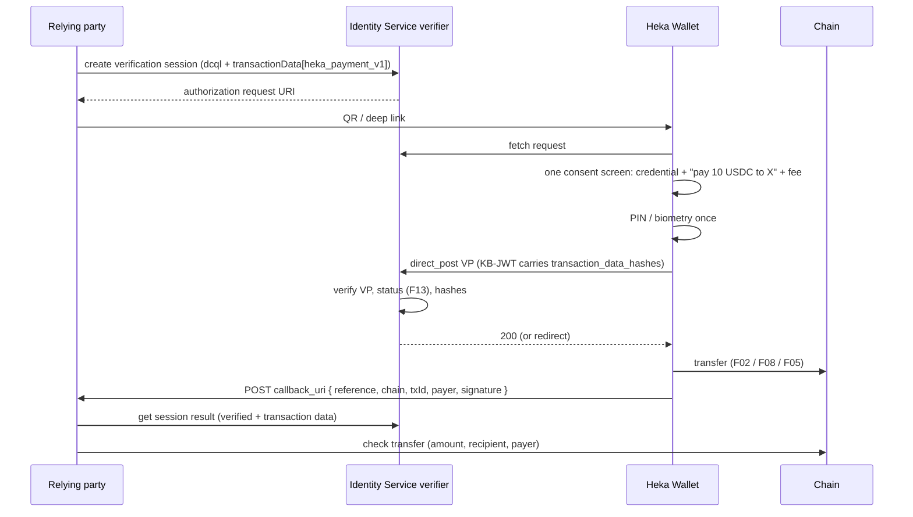

# F12 — Payment bound to an OID4VP presentation (`transaction_data`)

-   **Phase:** 3
-   **Depends on:** F02, F04, F06 (wallet); nothing in the wallet for the Identity Service part
-   **Gate:** none. Credo 0.7.0 supports it on both sides: `OpenId4VpVerifierServiceOptions` has `transactionData?: TransactionDataEntry[]` on create and returns verified `transactionData` entries on the verified response; the holder service handles it (`openid4vc-holder/OpenId4vpHolderService`).
-   **Design:** §1 use cases 1–2, §2.9 "Payment bound to a presentation"

## Goal

A relying party asks in one OID4VP request: "present your KYC credential and pay 10 USDC to X on Base Sepolia". The holder consents once, the presentation's key-binding signature covers the payment details, and the wallet pays only after the verifier accepted the presentation.

## Current state (checked in code)

-   Wallet: `transactionData` is resolved from the request (`app/src/credentials/openid4vc/resolvePresentationRequest.ts:57`) and passed through to Credo on response (`app/src/credentials/mappers/presentation.ts`, `app/src/credentials/dcApi/sendResponse.ts`). No screen shows it.
-   Identity Service: verification sessions accept `presentationExchange` or `dcql` (`src/openid4vc/verification-sessions/verification-session.service.ts`); there is no `transaction_data` anywhere in `src/`.

## Payment transaction-data type (proposal — agree before implementation)

One `transaction_data` entry (base64url JSON, per OpenID4VP 1.0):

```json
{
  "type": "heka_payment_v1",
  "credential_ids": ["kyc"],
  "chain": "eip155:84532",
  "asset": "eip155:84532/erc20:0x036CbD53842c5426634e7929541eC2318f3dCF7e",
  "amount": "10000000",
  "recipient": "eip155:84532:0xRecipient…",
  "reference": "opaque, single-use, bound to the verification session",
  "callback_uri": "https://relying-party/payments/callback"
}
```

`amount` is a decimal string in base units. The wallet supports this type only; a request with an unknown `type` is refused, as OpenID4VP requires. v1 covers SD-JWT VC credentials (the hash goes into the KB-JWT `transaction_data_hashes`).

## Flow



## Components

### Identity Service

-   `src/openid4vc/verification-sessions/dto/verification-session.dto.ts`: optional `transactionData: TransactionDataEntryDto[]` on create; `TransactionDataEntryDto` = `type` (required string), `credentialIds` (required, must match DCQL credential query ids), plus a free-form object for type-specific fields; class-validator rules; swagger annotations.
-   `verification-session.service.ts`: pass `transactionData` to Credo `createAuthorizationRequest`; only allowed with `dcql` and `version: 'v1'` (refuse with PEX / draft 21 with a 422); after verification, expose the verified transaction data and whether every entry's hash matched in the session result DTO.
-   Type check for `heka_payment_v1` fields (CAIP-2 / CAIP-19 / CAIP-10 shape, positive integer amount, `https` callback outside dev): a small validator in the verification-sessions module; unknown types pass through unvalidated (the verifier is generic).
-   Verification templates (`verification-template.e2e.test.ts` covers them): add `transactionData` to templates only if the demos create sessions from templates; otherwise leave templates unchanged.
-   No entity change expected if transaction data lives in Credo's verification session record; if the service stores it in its own entity → new migration (`db-migration` skill).

### Wallet — `app`

-   `app/src/screens/OpenIdPresentationRequest.tsx` (and the DC API sharing path `DcApiSharingScreen.tsx` if DC API requests can carry it): render each transaction-data entry; for `heka_payment_v1` embed `PresentationPaymentBlock` from `crypto/ui`; refuse the request if the crypto module is off, the chain or asset is not in the registry, or the balance cannot cover amount + fee.
-   After a successful response (2xx from `direct_post`, or a redirect) call the crypto module's `payForPresentation(entry)`; on a verifier error, do not pay and say why.
-   The PIN / biometry given for the presentation covers the payment (one consent); the `AuthProof` is passed to the key provider.

### Wallet — `packages/crypto/core`

-   `src/requests/PresentationPayment.ts`: parse and validate a `heka_payment_v1` entry into a `TransferRequest`; `payForPresentation` submits through `TransactionStore`, then POSTs `{ reference, chain, txId, payer, signature }` to `callback_uri`, where `signature` is an EIP-191 signature over `reference|txId` by the payer (F07 signer); retries the callback with backoff; the ledger keeps the reference.

### Wallet — `packages/crypto/ui`

-   `src/components/PresentationPaymentBlock.tsx`: chain, asset, amount (formatted with the registry's decimals), recipient, fee preview and fee mode, plus the "cannot pay" reasons; reuses `FeePreview`.
-   `usePresentationPayment` hook: validation state for the presentation screen and the post-response call to `payForPresentation`.

### Wallet — `packages/crypto/evm`

No change (uses F02 / F05 / F08 and F07).

### Identity Service web UI

-   Optional: a `transactionData` field in the verification-session or template form if the demos need it; not required for F14 if demos call the API.

### Demo

-   The relying-party side (callback endpoint, on-chain check) is in F14.

## Tests

-   Identity Service (`heka-identity-service/test/openid4vc-verification-session.test.ts`): create a session with `transactionData` + DCQL → the request contains `transaction_data`; with PEX → 422; invalid `heka_payment_v1` → 422; a holder response with correct hashes → session verified and transaction data returned; a response with a wrong or missing hash → not verified. Use the existing test holder agent.
-   Wallet unit: entry parsing and every refusal case; pay-only-after-2xx; callback payload and signature; retry.
-   Wallet component: presentation screen shows the payment block.
-   End to end (manual, then Maestro on demand): F14 compliance-gated scenario.

## Specs and docs

-   `specs/identity-service/`: verification-sessions page — the new field, constraints, result shape; swagger.
-   `specs/wallet/30-Features/Presentations.md`: transaction data rendering and pay-after-present.

## Acceptance criteria

-   One consent and one PIN produce both a verified presentation and an on-chain payment matching the request.
-   A rejected presentation never leads to a payment.
-   The verifier rejects a presentation whose KB-JWT does not cover the transaction data.

## Open questions

-   Credo's verified `transactionData` entries: confirm in a first test which credential's hash was checked and how a missing hash is reported (the option types exist in 0.7.0; behaviour is not yet exercised in this repo).
-   mdoc and W3C credentials: out of v1 unless Credo supports transaction data for them.
-   Payer binding strength: the callback signature proves the payer address cooperated, not that it belongs to the KYC holder. Issuer-attested address claims are the stronger option (F14 decision).
