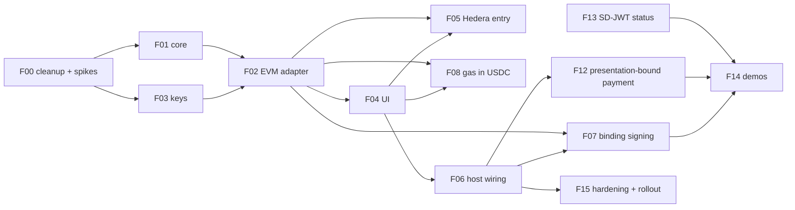

# Crypto wallet module — detailed plan

The design is in [`../Idea and high-level design.md`](../Idea%20and%20high-level%20design.md). This folder breaks it into one file per sub-feature. Each file has the same shape:

-   **Goal, scope, dependencies** — what the sub-feature delivers and what must land first.
-   **Components** — one section per component it touches: wallet `packages/crypto/core`, wallet `packages/crypto/ui`, wallet `packages/crypto/evm`, wallet `app`, wallet `packages/shared`, Identity Service, demo, others. A component with nothing to do says "No change".
-   **Tests**, **Specs and docs**, **Acceptance criteria**, **Open questions**.

## Sub-features

| File | ID | Sub-feature | Phase | Gate | Components |
| --- | --- | --- | --- | --- | --- |
| [F00](F00-cleanup-and-spikes.md) | — | ✅ Keplr cleanup and spikes A–D | 0 | — | wallet |
| [F01](F01-chain-agnostic-core.md) | F1 | ✅ Chain-agnostic core: types, registry, units, stores, local ledger | 1 | — | wallet |
| [F02](F02-evm-adapter.md) | F2 | ✅ EVM adapter (plain EOA path) | 1 | Spike A | wallet |
| [F03](F03-key-provider.md) | F3 | ✅ Key provider: seed, derivation, backup, reveal, import, remove | 1–2 | Spike C | wallet |
| [F04](F04-wallet-ui.md) | F4 | ✅ UI: register, home, receive, send, history, settings | 2 | — | wallet |
| [F06](F06-host-wiring.md) | F6 | ✅ Host wiring: flag, provider, tab, scanner, onboarding, i18n | 2–3 | — | wallet |
| [F05](F05-hedera-entry.md) | F5 | ✅ Hedera testnet through the EVM adapter | 1–2 | Spike B | wallet |
| [F07](F07-binding-signing.md) | F7 | Binding signatures: EIP-712, SIWE, nonce; signing-request channel | 1–2 | — | wallet, demo |
| [F08](F08-gas-in-usdc.md) | F8 | Gas paid in USDC (EIP-7702 + Circle Paymaster) | 1–2 | Spike D | wallet |
| [F09](F09-walletconnect.md) | F9 | WalletConnect v2 dApp pairing | 5 | — | wallet |
| [F10](F10-hedera-native-adapter.md) | F10 | Hedera-native adapter | 5 | — | wallet |
| [F11](F11-additional-assets-and-indexer.md) | F11 | EURC, more ERC-20 assets, price feed, indexer history | 5 | — | wallet |
| [F12](F12-presentation-bound-payment.md) | F12 | Payment bound to an OID4VP presentation (`transaction_data`) | 3 | F2, F4 | identity-service, wallet |
| [F13](F13-sd-jwt-credential-status.md) | F13 | Credential status on SD-JWT VCs (Token Status List) | 3 | — (#217) | identity-service, wallet |
| [F14](F14-demonstration-scenarios.md) | F14 | Demonstration scenarios | 3 | F12, F13 per scenario | demo, identity-service |
| [F15](F15-hardening-and-rollout.md) | — | Security review, specs, roadmap, rollout | 4 | MVP done | wallet, AI package specs |

MVP = F00–F08 (Phases 0–2). F12–F14 are the cross-component work the use cases need. F09–F11 are stretch.

## Order and dependencies

F06 follows F04 directly (re-ordered 2026-11-10), so the wallet can be opened and tested on Base Sepolia before F05, F07 and F08; F07 then adds its signing-request route to F06's scanner. F04 built the Hedera and paymaster UI from adapter capabilities, so it shows once F05 and F08 deliver those.

F13 has no wallet dependency and can start at any time on the Identity Service side.

## Package layout

All payment packages live in `heka-wallet/packages/crypto/`; the root workspaces gain `packages/crypto/*`.

| Folder | Package | Holds | Depends on |
| --- | --- | --- | --- |
| `packages/crypto/core` | `@heka-wallet/crypto-core` | Types, registry, key provider, stores, ledger, request parsers, units. No React / React Native. | — |
| `packages/crypto/ui` | `@heka-wallet/crypto-ui` | `CryptoProvider`, `CryptoStack`, screens, components, hooks. | `crypto-core`, `shared` |
| `packages/crypto/evm` | `@heka-wallet/crypto-evm` | `EvmAdapter`, chain entries, `aa/`, `hedera/`, signing. | `crypto-core`, viem |
| `packages/crypto/hedera` (F10) | `@heka-wallet/crypto-hedera` | Hedera-native adapter. | `crypto-core` |
| `packages/crypto/walletconnect` (F09) | `@heka-wallet/crypto-walletconnect` | WalletKit session and requests. | `crypto-core` |

The `app` depends on `crypto-ui` and registers the adapters from `crypto-evm`.

## Components at a glance

| Component | Sub-features with work |
| --- | --- |
| `heka-wallet/packages/crypto/core` (new) | F01, F03, F05, F07, F08, F09, F11, F12 |
| `heka-wallet/packages/crypto/ui` (new) | F03, F04, F06, F07, F08, F09, F11, F12 |
| `heka-wallet/packages/crypto/evm` (new) | F02, F05, F07, F08, F11 |
| `heka-wallet/app` | F00, F03 (backup prompt), F06, F12, F13 (optional) |
| `heka-wallet/packages/shared` | F00 (locale keys of `ConfirmationInputModal`) |
| `heka-identity-service` | F12, F13, F14 (only for an issuer-attested address claim) |
| `demo` | F07 (test signing-request issuer), F14 |
| `heka-identity-service-web-ui` | Optional: F12 (`transaction_data` in a verification template form) |
| `heka-sso-service`, `heka-sso-web-ui` | No change |
| AI package specs (`specs/wallet`, `specs/identity-service`, `specs/demo`) | Every sub-feature that changes code updates its specs in the same change |

## Rules every sub-feature follows

-   Tests policy B: a test with every new flow or endpoint, a regression test with every bug fix; no weakened assertions.
-   Wallet: new dependencies at exact versions; line coverage for `heka-wallet` stays at or above 60 %; one component per file; no `any`; Maestro flow for every new user flow.
-   Identity Service: entity change → new migration; swagger for every new or changed endpoint; e2e test in `heka-identity-service/test/`.
-   No keys, mnemonics or vendor API keys in code, config defaults or `.env.example`. Test accounts are funded from faucets and their keys come from a local, untracked env file.
-   One commit per app touched; scopes `wallet`, `identity-service`, `demo`.
